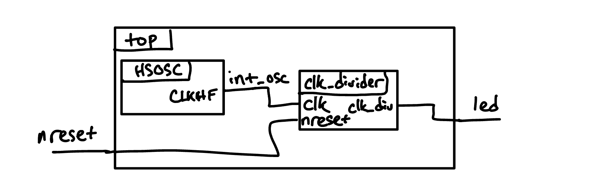
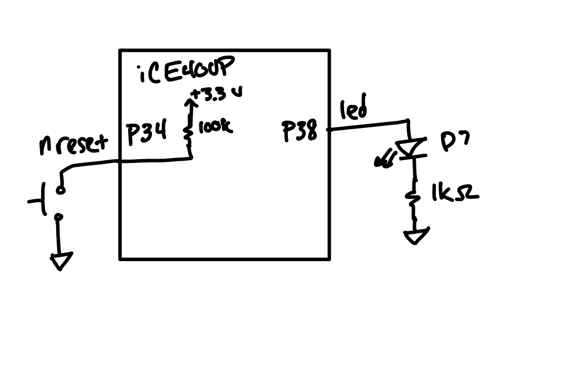
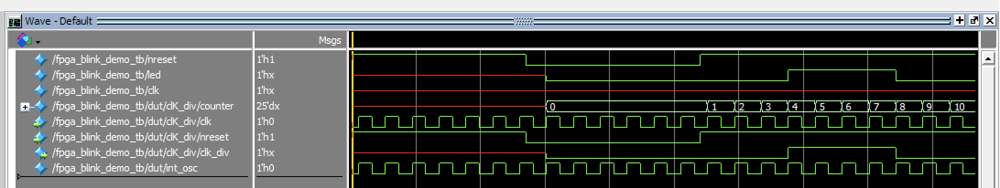

::: {.callout-tip title="Annotated Report Template"}
The following is a template to clarify what should be part of the writeup you post for each lab you complete.
It is a sample report written to explain a simple FPGA blink demo.
Each section contains a brief explanation of the purpose of the section and the information that should be included in it.
Your report is graded against the [lab writeup specifications](/lab/specs/) and the specs for each lab, so check it against those before submitting.
:::

## Introduction

::: {.callout-note title="Introduction" }
Briefly explain what was done.
:::

In this lab, a design was implemented on the FPGA to demonstrate the functionality of the on-board high-speed oscillator by blinking one of the on-board LEDs.
The high speed oscillator was configured at a frequency of 24 MHz and divided down using a counter to achieve a blinking frequency of ~1.5 Hz.

## Design and Testing Methodology

::: {.callout-note title="Design and Testing Methodology" }
Explain how you approached the design of this assignment from both a software and a hardware standpoint (as appropriate). Include how you tested your design. These tests should convince the reader that the requirements of the assignment have been met.
:::

The on-board high-speed oscillator (`HSOSC`) from the iCE40 UltraPlus primitive library was used to generate a clock signal at 24 MHz.
Then, a counter was used to divide the high frequency clock signal down so that the blinking frequency could be easily visualized using one of the on-board LEDs.

The design was developed using a simple clock divider module which drives the on-board LED.

## Technical Documentation:

::: {.callout-note title="Technical Documentation" }
Include a link to a Git repository with your Verilog code, a block diagram of your design, and schematics of your circuits.
Use spoiler tags (collapsed callouts) to hide screenshots and code that are not essential to the narrative, as shown below.
:::

::: {.callout-note collapse="true" title="Example spoiler: click to expand"}
Put code listings, extra waveform screenshots, and long transcripts inside a collapsed callout like this one so the report stays easy to read.
:::

The source code for the project can be found in the associated [Github repository](https://github.com/HMC-E155/fpga-blink-test-demo).

### Block Diagram

::: {#fig-block-diagram}

Block diagram of the Verilog design.
:::

The block diagram in @fig-block-diagram demonstrates the overall architecture of the design.
The top-level module `top` includes two submodules: the high-speed oscillator block (`HSOSC`) and the clock divider module (`clk_divider`).  Every net and port in the block diagram must be labeled -- that means each wire at the top level has to have a name, and the connection to a submodule must show the name inside the module.  This is true even if the submodule port name is the same as the top level net name.

### Schematic
::: {#fig-schematic}

Schematic of the physical circuit.
:::

::: {.callout-warning title="Schematic does not yet meet current specs"}
This example schematic predates the current [schematic specifications](/lab/specs/). In your report, draw only off-board components, do not draw parts internal to the chip (such as internal pull-up resistors), label every part with its part number, and include a title block. Your schematic must match the circuit as it is actually built on your board.
:::

@fig-schematic shows the physical layout of the design.
The reset pushbutton and LED D7 are on the development board; see the [E155 Development Board Schematic](/assets/doc/E155%20Development%20Board%20Schematic.pdf) for their connections.
An internal 100 k$\Omega$ pullup resistor was used to ensure the active low reset pin was not floating.
The output LED was connected using a 1 k$\Omega$ current-limiting resistor to ensure the output current (~2.6 mA) did not exceed the maximum output current of the FPGA I/O pins.

## Results and Discussion

::: {.callout-note title="Results and Discussion" }
Did you accomplish all of the prescribed tasks? If not, what are the shortcomings? How might you address them given more time? As appropriate, how did the design perform (e.g., How fast/accurate/reliable was it?).
:::

### Testbench Simulation

::: {#fig-testbench}

A screenshot of a QuestaSim simulation demonstrating the blinking output signal. Note that the timescale for the clock divider was modified to divide by 4.
:::

The design meets all of the requirements for this demo.
@fig-testbench shows a screenshot of the QuestaSim simulation.
If a more precise output frequency was desired, a more sophisticated counter could be developed.
The current design only allows for the clock to be divided by powers of two.

## Conclusion

::: {.callout-note title="Conclusion" }
Briefly summarize what was done and how it performed. Also note how many hours you spent working on the lab.
:::

The design successfully blinked an on-board LED using the on-board high-speed oscillator.
I spent a total of two hours working on this lab.

## AI Prototype Summary

::: {.callout-note title="AI Prototype Summary" }
Include generated code, easy-to-read chat transcripts, and a reflection on how well it worked. Put long code and transcripts in spoiler tags.
:::