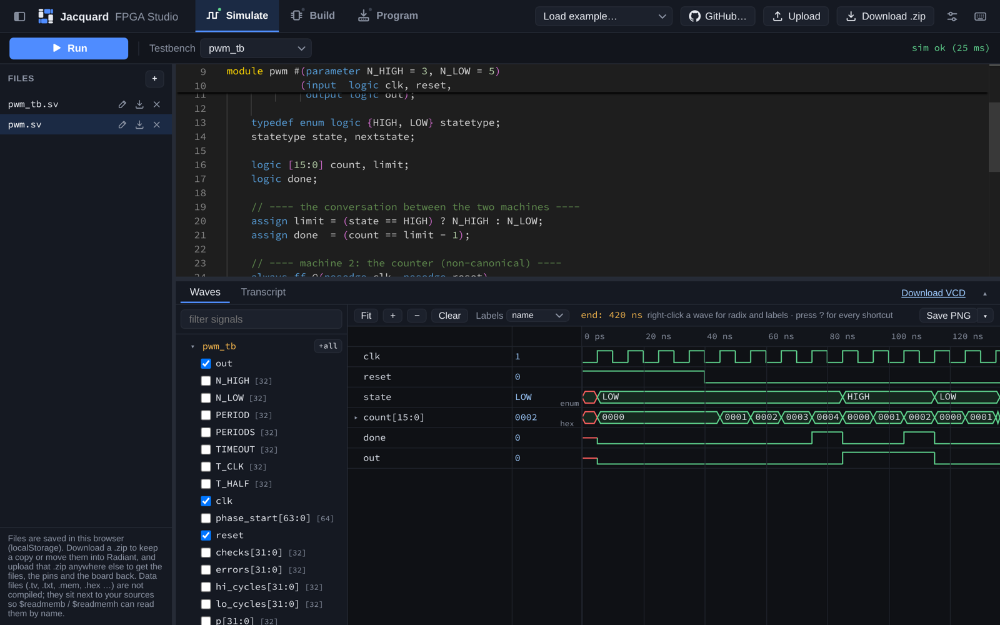
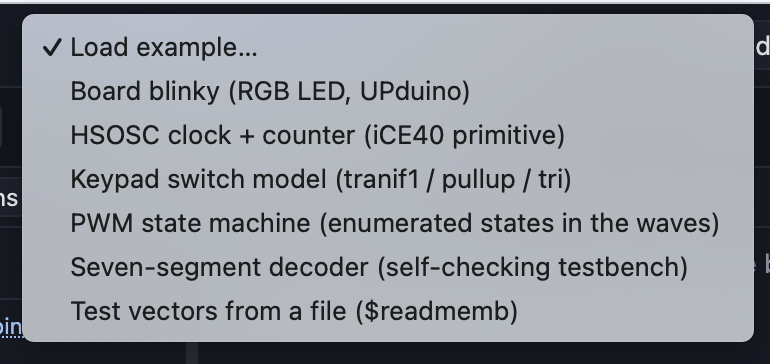
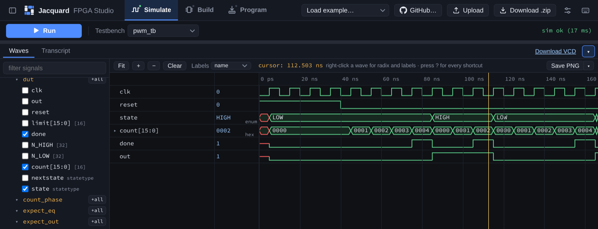
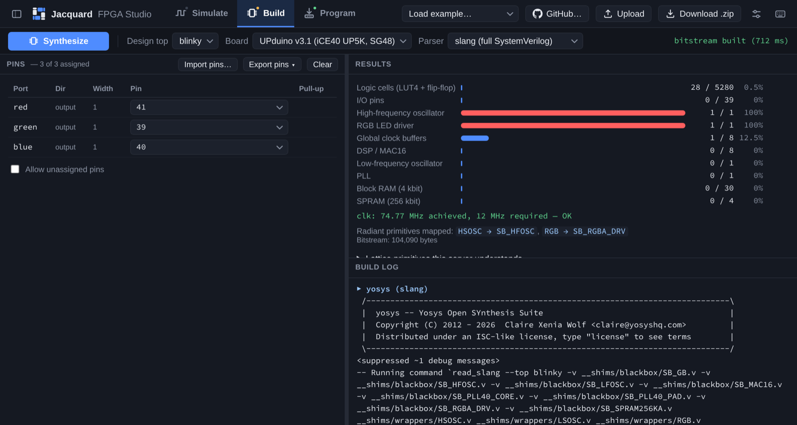
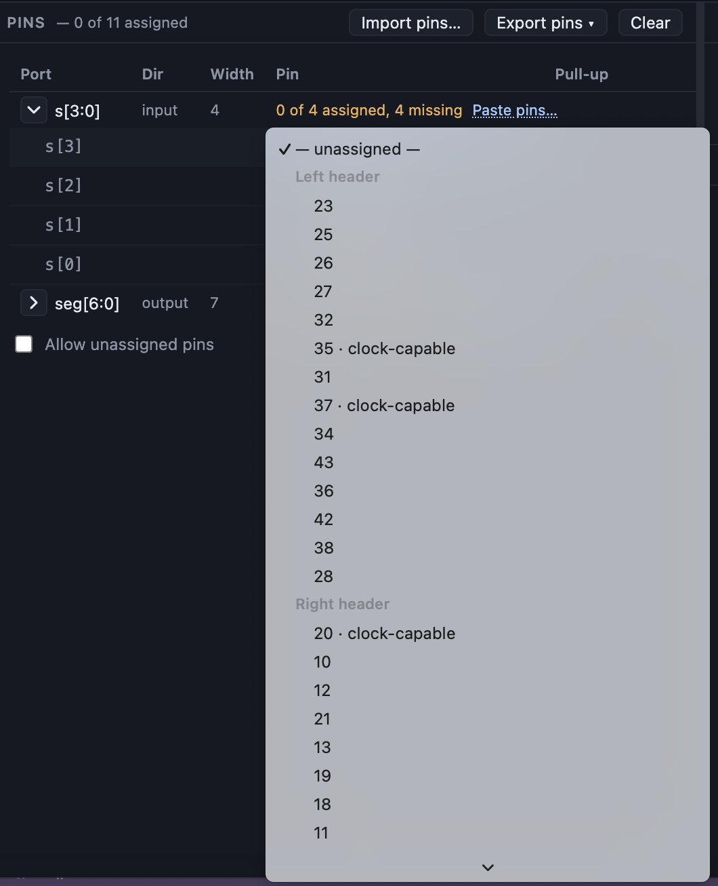
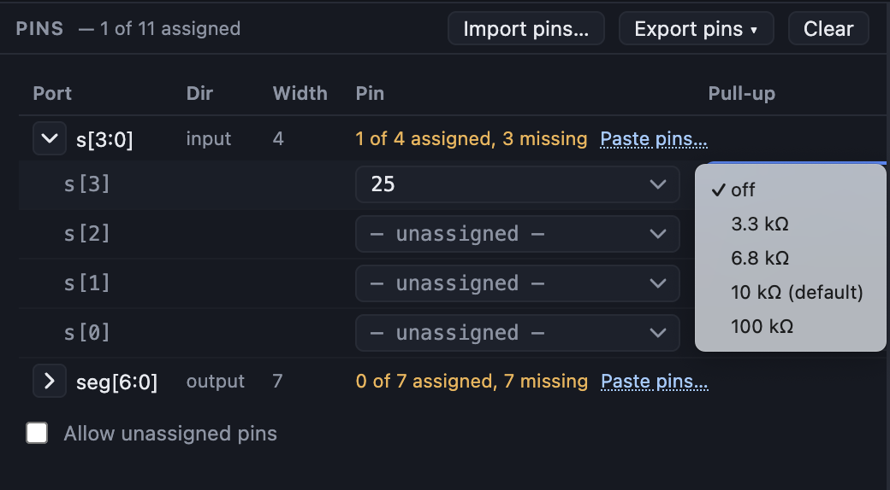
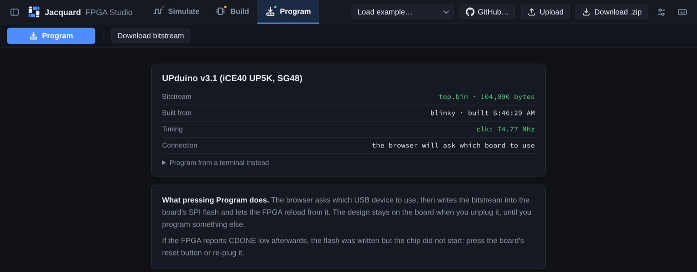

## Introduction

[Jacquard FPGA Studio]() is a browser-based tool for writing, simulating, synthesizing, and programming iCE40 FPGA designs. Everything happens in a browser tab, so there is nothing to install and no license to set up, and it works the same on Mac, Windows, and Chromebooks.

Behind the scenes, Jacquard runs open-source tools on a server: [Icarus Verilog](https://steveicarus.github.io/iverilog/) for simulation, and [yosys](https://yosyshq.net/yosys/) and [nextpnr](https://github.com/YosysHQ/nextpnr) for synthesis and place-and-route. The resulting bitstream is written to your UPduino's flash over USB directly from the browser.

This tutorial covers the full Jacquard workflow: loading files, simulating a testbench, assigning pins, synthesizing, and programming the board. It also covers the places where Jacquard behaves differently from QuestaSim and Radiant, which are worth reading before you rely on it for a lab.

::: {.callout-note title="Related tutorials"}
Jacquard is an alternative to the Radiant and QuestaSim workflow. The ideas are the same in both tools, so the Radiant tutorials are still worth reading for background:

- [Lattice Radiant iCE40 UltraPlus Project Setup](/tutorials/tutorial-posts/lattice-radiant-ice40-ultraplus-project-setup/) — synthesis, pin assignment, pull-up resistors, and programming.
- [QuestaSim/ModelSim Simulation](/tutorials/tutorial-posts/modelsim-simulation-tutorial/) — writing and running testbenches.
- [openFPGALoader Programmer](/tutorials/tutorial-posts/openfpgaloader-programmer/) — the command-line programmer, which you can use if your browser cannot program the board directly.
:::

::: {.callout-warning title="Check with your instructor before using Jacquard for a lab"}
Jacquard is new. Unless your lab specification or an instructor says otherwise, assume Radiant and QuestaSim are the tools used for checkoffs and lab reports. Jacquard is a good way to iterate quickly, especially on a laptop or Chromebook where Radiant will not run.
:::

## Getting Started {#getting-started}

Go to [jacquardfpga.com](), click `Log in`, and sign in with your `g.hmc.edu` Google account. Other Google accounts will not work.

The first time you sign in, a short banner asks what Jacquard may record about how you use it. Both options are optional, and you can change your answer later under `Settings → Privacy`.

### Browser and USB Setup {#browser-setup}

Simulating and synthesizing work in any browser. Programming the board from the browser uses WebUSB, which needs Chrome or Edge. The UPduino's programmer is an FTDI FT232H chip, so a little setup may be needed depending on your operating system:

| | Program from the browser | Download + openFPGALoader |
| --- | --- | --- |
| macOS | Works, unless you have installed FTDI's own VCP driver | Works |
| Linux | Needs a udev rule — Jacquard shows you the line to copy | Works (the package ships udev rules) |
| ChromeOS | Works | n/a |
| Windows | Needs a one-time [Zadig](https://zadig.akeo.ie/) driver swap (FTDIBUS → WinUSB) | Also needs Zadig |

On Windows, the Zadig swap is needed for **either** route, since neither can use FTDI's own driver. The [openFPGALoader tutorial](/tutorials/tutorial-posts/openfpgaloader-programmer/#windows-install) walks through it. If your browser cannot program the board, Jacquard will tell you and point you to the fallback (see [Programming from a Terminal](#program-from-terminal)).

### The Jacquard Window {#interface}

Jacquard is split into three screens, selected with the tabs along the top: `Simulate`, `Build`, and `Program`. Each screen has its own controls, but they all work on the same set of files. Each tab also has a small status dot — red for a failed run, green for a built bitstream — so you can see that a build broke while you are still looking at waveforms.

The files in your project are listed in the Files panel on the left. Clicking a file opens it in the editor in the middle of the window. The icons next to each file let you rename, download, or delete it, and the `+` button at the top of the panel creates a new file.

The buttons on the right side of the top bar manage the project as a whole: `Load example...`, `GitHub...`, `Upload`, and `Download .zip`. Each of these is covered below.

::: {#fig-jacquard-simulate}


The Jacquard Simulate screen.
:::

A few keyboard shortcuts are worth learning right away:

| Shortcut | Action |
| --- | --- |
| `Ctrl`/`⌘`+`1`, `2`, `3` | Switch to Simulate, Build, or Program |
| `Ctrl`/`⌘`+`Enter` | Run the simulation |
| `Ctrl`/`⌘`+`Shift`+`Enter` | Synthesize |
| `?` | Show every shortcut |

### Projects and Storage {#projects}

The chip next to the Jacquard logo is a project switcher. Each project has its own files, testbench, board, and pin assignments, so you can set aside one lab to look at another without mixing their files. The switcher also marks which projects have a copy on GitHub and which exist **only in this browser**.

::: {.callout-warning title="Save your work"}
Jacquard stores your files in your browser, not on a server. They will still be there if you close the tab, but they will not follow you to another computer or browser, and they will be lost if you clear your browser data. Nothing is backed up for you.

Browser storage is also limited, to roughly 5 MB for the whole site shared across every project, so do not use Jacquard as an archive. Keep your work in a Git repository using the [GitHub integration](#github), or click `Download .zip` often. The `.zip` includes your pin assignments and board choice along with your source files.
:::

## Adding Files {#adding-files}

### Loading an Example {#examples}

Click `Load example...` to open one of the built-in example projects. These are a good way to get familiar with Jacquard before using it on your own code.

::: {#fig-load-example}
{width="60%"}

Built-in example projects.
:::

If this is your first time using Jacquard, start with `Board blinky`. It blinks the RGB LED on the UPduino and goes through simulation, synthesis, and programming, so it is a quick way to check that your browser, cable, and board all work. The `HSOSC clock + counter` example is also worth a look since it uses the same `HSOSC` oscillator you will use in Lab 1.

### Creating and Uploading Files {#uploading}

To start a new file, click `+` at the top of the Files panel and give it a name ending in `.sv`, such as `lab1_xx.sv`.

To bring in files you already have, click `Upload` and select them. You can also upload a `.zip` that you previously downloaded from Jacquard, which brings back your source files along with your pin assignments.

### Test Vectors and Data Files {#data-files}

Along with SystemVerilog files, you can upload test vector and memory files (`.tv`, `.txt`, `.dat`, `.mem`, `.hex`, `.bin`, `.csv`, `.vec`). These are not compiled, so a file full of `0110_1` lines will not cause a syntax error. They are copied next to your source files when the simulation runs. Header files (`.svh`, `.vh`) are handled the same way, so `` `include "defs.svh" `` works.

The Jacquard workspace is **flat**: every file is in one directory, with no subfolders. That means `$readmemb` finds a file by its name alone:

```systemverilog
logic [10:0] testvectors[10000:0];
initial $readmemb("fulladder_testvectors.tv", testvectors);   // works
```

but a path with folders in it does not:

```systemverilog
initial $readmemb("vectors/fulladder_testvectors.tv", testvectors);   // will not resolve
```

If `$readmemb` names a file that is not in the workspace, the transcript tells you which line it was called from, instead of leaving you with an array full of `x`.

::: {.callout-note title="Uploading a zip from Radiant"}
An uploaded `.zip` is flattened to fit the workspace, so `lab3/src/top.sv` arrives as just `top.sv`. If two files in different folders have the same name, only one of them is kept, so check the file list after a big upload.
:::

### Opening a Project from GitHub {#github}

If your code is already on GitHub, click `GitHub...` and paste the URL of the repository, or of a folder inside it, straight from your browser's address bar. The short form works too:

```
https://github.com/hmc-e155/labs/tree/main/lab3
hmc-e155/labs/tree/main/lab3
```

The same thing works as a link, which is handy for sharing starter code: `/?gh=hmc-e155/labs/tree/main/lab3` opens that folder in a fresh workspace.

Before anything is replaced, Jacquard shows a preview of which commit it will load, which files will be added, and anything it skipped and why. Since the workspace is flat, subfolders are flattened too, and an include like `` `include "../rtl/defs.svh" `` will stop working. The preview warns you about these.

Your lab repositories are private. To open them, link your GitHub account once under `Settings → GitHub → Link GitHub`. GitHub will ask which repositories to share, and Jacquard can only read those. Linking is optional; uploading files and opening public repositories both work without it.

#### Choosing a Commit

Jacquard loads the repository at a specific commit, and the top bar shows it as `repo@sha`. Clicking it opens a menu:

| Option | What it does |
| --- | --- |
| `Update to latest` | Load the commit the branch points to now. A dot appears on the chip when the branch has moved on. |
| `Choose a commit...` | Pick from recent commits that touched this folder. Useful when something worked yesterday and you want to find what broke. |
| `Switch branch...` | Follow a different branch from here on. |
| `Open on GitHub` | Open that exact commit on GitHub. |
| `Forget the repository` | Keep the files but drop the link to GitHub. |

If loading a different commit would overwrite files you have edited, Jacquard lists them by name first.

#### Pushing Your Work Back {#pushing}

`Commit and push` in the repository menu creates a new branch off the commit you loaded and commits your files to it. Pushing again adds another commit to the same branch, so it is fine to push several times during a lab session: before trying something risky, after getting a test to pass, and at the end of the day.

Jacquard follows four rules when pushing, so you can trust it with your repository:

1. It only ever **creates** a branch, or adds to one it created. It never writes to a branch that already existed, and it refuses to push to the default branch.
2. It never force-pushes.
3. It never merges, and never touches a pull request.
4. It never deletes a file from the repository unless you check the box that names it.

When you are done, `Open a pull request...` takes you to GitHub's compare page with the title and the transcript of your last simulation already filled in. Jacquard does not open the pull request itself; you submit it on GitHub.

::: {.callout-note title="A push is a checkpoint, not a save button"}
Pushing is something you do often; opening a pull request is something you do once. Commit often during a session, and open one pull request at the end.
:::

## Simulating {#simulating}

On the `Simulate` screen, select your testbench module from the `Testbench` dropdown and click `Run` (or press `Ctrl`/`⌘`+`Enter`). When the simulation finishes, `sim ok` appears in the top right along with how long it took.

The panel below the editor has two tabs. `Transcript` shows compiler messages and anything your testbench prints with `$display` or `$error`, including the pass/fail messages from a self-checking testbench. If your code does not compile, clicking the file and line number in an error jumps to that line in the editor. `Waves` shows the waveform viewer. A clean run opens the Waves tab, and a failed run opens the Transcript. Click `▴` or double-click the divider to expand the panel over the editor.

See [Designing a Good Testbench](/tutorials/tutorial-posts/modelsim-simulation-tutorial/#designing-a-good-testbench) for how to write a testbench that checks itself. Everything in that section applies here.

::: {.callout-tip title="You do not need $dumpvars"}
Jacquard adds `$dumpvars` for you, so every signal in your design shows up in the waveform viewer. If your testbench already has its own `$dumpfile`/`$dumpvars`, Jacquard leaves it exactly as written. If you copied a testbench that only dumps some signals and are wondering why the rest are missing, that is why.
:::

### Reading Waveforms {#waveforms}

The `Waves` tab shows the simulation results as a waveform. The signal list on the left shows every module in your design. Check the box next to a signal to add it to the waveform, or click `+all` to add everything in a module. If you have a lot of signals, the filter box at the top searches by full signal path. Parameters are left out of the waveform at first, but you can still find them in the signal list.

Use `Fit` (or `F`) to zoom out to the whole simulation, or `+` and `−` to zoom in and out. You can also zoom with `Ctrl`/`⌘` and the scroll wheel, pan by dragging or with `Shift` and the scroll wheel, and drag across the time axis to zoom in on a specific window. Clicking in the waveform places a cursor and shows its time in the toolbar.

A few other things that are useful to know:

- Click a signal's value to cycle through hex, binary, decimal, signed decimal, and ASCII. Right-click a signal for a menu with the same options plus `Copy full path`, reordering, and removing it.
- Drag signals up and down to rearrange them, or select one and use `Alt`+`↑`/`↓`. `Delete` removes it. Your order is kept the next time you run, so you can group a bus with its control signals before taking a screenshot.
- Click the arrow next to a bus, such as `count[15:0]`, to expand it into individual bits.

Jacquard also reads the names from any `typedef enum` in your code, so state machine states show up by name (for example `HIGH` and `LOW`) instead of as numbers. This makes FSMs much easier to debug. See [Enumerated States](#enumerated-states) for more detail.

::: {#fig-jacquard-waves}


The waveform viewer. The `state` signal is an enum, so its values are shown by name.
:::

### Waveforms for Lab Reports {#save-png}

To include a waveform in your lab report, click `Save PNG` (or press `s` with the waveform selected). This saves the signals currently on screen, in the order you arranged them, as a light-themed image at 2× resolution, with a caption showing the top module and time range. That is much easier to read in a report than a photo of a dark screen. The `▾` next to it lets you change the theme, resolution, time range, and caption, or copy the image to your clipboard. `Copy transcript` does the same for the text output.

As with QuestaSim, set the radix so values are readable at the zoom level you capture, and include the signals that actually show the behavior you are describing.

### Enumerated States {#enumerated-states}

A waveform file on its own does not record that `state` was declared as a `statetype`; it just stores the bits. Jacquard reads the `typedef enum` declarations from your source code and matches them up with your signals, which is how it can show state names. Hover over a signal in the list to see its full encoding.

This works for anonymous enums, enums imported from a `package`, enums with explicit values, and one-bit enums. Jacquard shows the raw bits instead of a name in three cases, since a wrong state name would be worse than a number:

- A member whose value is a parameter or expression, such as `typedef enum {A = START, B} t;`.
- Two different enums with the same type name in one project.
- A value that does not match any member, or is `x` or `z`. If your FSM ends up in an undefined state, it should look wrong.

None of this changes the simulation itself. The labels are only a display layer on top of the results.

## Differences from QuestaSim {#icarus-differences}

Jacquard simulates with Icarus Verilog instead of QuestaSim. For the SystemVerilog used in this course they agree, but there are a few differences you should know about.

### Code That Runs but Is Wrong

The three cases below compile and run with no errors, but do **not** do what your code says. Icarus does not warn about them, so Jacquard adds a warning to the transcript when it sees one.

| What you wrote | What actually happens | Do this instead |
| --- | --- | --- |
| `assert property (...)` | It is **never checked**. A property that fails every cycle prints nothing, so a broken design looks like it passed. | Use an immediate `assert (cond) else $error(...)` inside a clocked block. |
| `unique`, `unique0`, or `priority` on a `case` | The keyword is **ignored**. Overlapping or missing cases are not reported like they are in QuestaSim. | Add a `default:` case that calls `$error`. |
| Some files missing `` `timescale `` | A file without one uses whichever timescale was compiled before it, or a 1 s default, so `#5` might mean 5 **seconds**. | Put `` `timescale 1ns/1ps `` at the top of **every** `.sv` file. |

### Code That Will Not Compile

These give an error with a file and line number, so they are easy to find, but it helps to recognize them:

| Construct | Error you will see |
| --- | --- |
| `interface` / `modport` | syntax error |
| unpacked `struct` | `sorry: Unpacked structs not supported` |
| associative arrays (`int m[string]`) | `Type names are not valid expressions` |
| `case ... inside` | syntax error |
| string methods (`.toupper()`, ...) | `is not a string method` |
| `clocking` blocks | syntax error |
| `unique if` / `priority if` | syntax error |
| `automatic` variables inside `initial`/`always` | `Overriding the default variable lifetime...` |
| `$past`, `$system` | `not defined by any module` (when the simulation runs) |

Everything this course uses is supported, including `logic`, `always_ff` / `always_comb` / `always_latch`, `typedef enum` (and `.name()`), packed structs and arrays, `package` / `import`, `generate`, tasks with `output` arguments, `#` delays, `fork`/`join`, `$clog2`, `$sformatf`, `$signed`, `$readmemb` / `$readmemh`, `$monitor`, `$display`, `$random` / `$urandom`, `tranif1` / `pullup` / `tri` (for keypad models), `x`/`z` values, and immediate assertions.

### Lattice Primitives in Simulation {#primitives}

Jacquard includes simulation models for `HSOSC`, `LSOSC`, `SB_HFOSC`, `SB_LFOSC`, and `RGB`, so a design that uses `HSOSC` simulates without any extra setup. You do not need the [iCE40 library step](/tutorials/tutorial-posts/modelsim-simulation-tutorial/#libraries) from the QuestaSim tutorial.

Since a top module that uses `HSOSC` makes its own clock, its testbench should not drive a `clk` input. Let the oscillator run, and simulate long enough to see what you are checking.

### Simulation Time Limit

A simulation that runs too long is stopped automatically, so a missing `$finish` will not hang. You still get everything up to that point, and the transcript tells you the waveform was cut short.

## Building {#building}

The `Build` screen is where you assign pins and synthesize your design. At the top of the screen, set `Design top` to your top-level module (not your testbench — this is the most common mistake on this screen) and set `Board` to `UPduino v3.1 (iCE40 UP5K, SG48)`. Leave `Parser` on its default setting.

::: {#fig-jacquard-build}


The Build screen.
:::

### Assigning Pins {#pin-assignment}

As in Radiant, you need to tell Jacquard which physical FPGA pin each input and output should connect to. The `Pins` table lists each port of your top-level module. Unlike Radiant, you do not need to synthesize first for your signals to show up.

Choose a pin number for each port from the dropdown in the `Pin` column. The dropdown groups the pins by which header of the UPduino they are on, and marks the pins that can be used as clock inputs. The four pins used by the SPI flash are greyed out, and the RGB LED pins are marked. For a bus like `s[3:0]`, click the arrow to expand it and assign each bit separately.

::: {#fig-pin-assign}
{width="60%"}

Choosing a pin for one bit of a bus.
:::

The table keeps track of how many pins you have assigned, and marks a conflict if you put two signals on the same pin. If any port is left unassigned, the build will fail instead of placing it on a random pin. If you only want to synthesize to check resource usage, check `Allow unassigned pins`.

To find the right pin numbers, check the [E155 Development Board Schematic](/assets/doc/E155%20Development%20Board%20Schematic.pdf) and the [Finding the Right Pin Numbers](/tutorials/tutorial-posts/lattice-radiant-ice40-ultraplus-project-setup/#finding-the-right-pin-numbers) section of the Radiant tutorial. The same warnings about pins shared with the MCU apply here.

### Pull-Up Resistors {#pull-up-resistors}

Inputs connected to DIP switches or buttons need a pull-up resistor so that they read a valid logic high when the switch is open. Set this in the `Pull-up` column next to the pin. The options are 3.3 kΩ, 6.8 kΩ, 10 kΩ, and 100 kΩ, and `10 kΩ` is a good default. The pull-up setting is disabled until the port has a pin assigned. See [Configuring Pull-Up Resistors](/tutorials/tutorial-posts/lattice-radiant-ice40-ultraplus-project-setup/#pull-up-resistors) in the Radiant tutorial for more background.

::: {#fig-pin-resistors}
{width="60%"}

Setting a pull-up resistor on an input.
:::

### Importing and Exporting Pins {#import-export-pins}

If you have already assigned your pins in Radiant, click `Import pins...` and select your `.pdc` file instead of entering them again. `Export pins` does the reverse, so you can move a design from Jacquard into Radiant. Your pin assignments are also saved in the `.zip` when you click `Download .zip`.

### The `pins.pcf` File {#pins-pcf}

Once you assign a pin, a file called `pins.pcf` appears at the bottom of the Files panel. It contains the same information as the pin table, in the format that is actually passed to the build. You can edit it directly, and the table updates to match: changing a `set_io` line moves that pin, deleting a line unassigns it, and deleting the file clears all assignments.

The two comments at the top record your board and top module:

```tcl
# jacquard-board: upduino-v3.1
# jacquard-top: sevenseg
set_io -nowarn s[3] 35
```

nextpnr and Radiant ignore these lines, but Jacquard reads them, so a project you move to another browser opens with the right board and top module already selected.

### Synthesizing {#synthesizing}

Click `Synthesize` (or press `Ctrl`/`⌘`+`Shift`+`Enter`). A design for this course builds in about a second. When it finishes, `bitstream built` appears in the top right, and the Results panel shows how much of the FPGA your design uses, such as logic cells, I/O pins, oscillators, and block RAM. As with Radiant, check that the number of registers and pins matches what you expect from your design. A counter that uses ten times the registers you intended is telling you something.

Below the resource usage, Jacquard reports the maximum clock frequency your design can run at and whether it meets the clock speed you are using. It also lists any Lattice primitives it converted for the open-source tools, such as `HSOSC → SB_HFOSC` and `RGB → SB_RGBA_DRV`. This means your `HSOSC` instance works without needing any changes to your code. If you write your own module with one of these names, yours is used instead and the build log says so.

If something does not look right, the full synthesis output is in the Build Log at the bottom of the screen.

## Programming {#programming}

Plug in your UPduino and go to the `Program` screen. Before programming, check the summary to make sure the bitstream was built from the design you expect.

Click `Program`. Your browser will ask which USB device to use. Select your UPduino and connect. Jacquard then writes the bitstream to the board's flash memory, and the FPGA reloads and starts running your design. Your design stays on the board after you unplug it, until you program something else.

If programming does not work, check the [Browser and USB Setup](#browser-setup) table for your operating system.

::: {#fig-jacquard-program}


The Program screen.
:::

If Jacquard reports that CDONE is low after programming, the flash was written but the FPGA did not start up. Press the reset button on the board, or unplug it and plug it back in.

### Programming from a Terminal {#program-from-terminal}

If your browser cannot program the board, click `Program from a terminal instead` for a command you can run in your terminal. You can also click `Download bitstream` to save the `.bin` file and program it with [openFPGALoader](/tutorials/tutorial-posts/openfpgaloader-programmer/):

```
openFPGALoader -b ice40_generic -c ft232 -f top.bin
```

## Troubleshooting {#troubleshooting}

**"Unknown module type" for a module that is in the file list.**
Check the file's extension, since data files are not compiled. Also, if you uploaded a `.zip` with two files of the same name in different folders, only one of them was kept (see [Test Vectors and Data Files](#data-files)).

**My testbench passes but the design is broken.**
Check the table in [Code That Runs but Is Wrong](#icarus-differences). `assert property` is the usual cause: it compiles and runs but is never checked.

**Waveform timings are off by a huge factor.**
A file is missing its `` `timescale ``. Put `` `timescale 1ns/1ps `` at the top of every `.sv` file.

**The waveform panel is empty.**
If your own `$dumpvars` never runs, for example because it is inside an `if` or in a module nothing instantiates, Jacquard reruns the simulation with every signal dumped, so this should be rare. If it still happens, delete your `$dumpvars` and let Jacquard add its own.

**The build fails on a pin.**
Every port needs a pin, so the build fails if one is missing. Open `pins.pcf` to see exactly what the build was given.

**The build works but the board does nothing.**
Check that `Design top` is your design and not your testbench, and check your pin numbers against the [board schematic](/assets/doc/E155%20Development%20Board%20Schematic.pdf). The [troubleshooting section of the Radiant tutorial](/tutorials/tutorial-posts/lattice-radiant-ice40-ultraplus-project-setup/#troubleshooting) covers hardware problems like solder bridges and pins shared with the MCU, which apply here too.

**"Server busy — press Run again".**
Runs are queued, and if a whole lab section clicks Run at once the queue can briefly fill up. Click Run again.

**My files are gone.**
Check the project switcher first, since you may be in a different project. If you are in a different browser or on a different computer, your files are still in the one you saved them in. This is what the GitHub integration and `Download .zip` are for.

::: {.callout-important title="Working on Lab 1?"}
You have finished this tutorial. Go back to the [Lab 1 tutorial list](/lab/lab1/#part-1-tutorials) and continue.
:::


